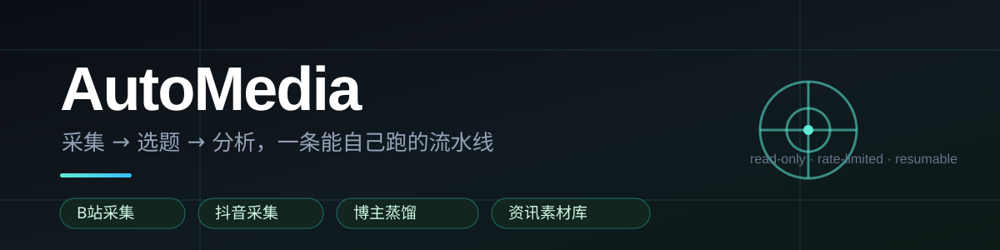
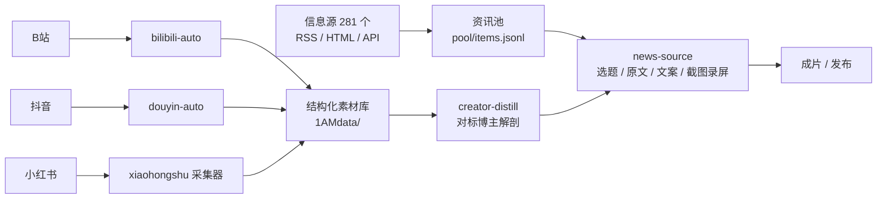

# AutoMedia

> 把「采集 → 选题 → 分析」变成一条能自己跑的流水线：**B站 / 抖音 / 小红书** 只读采集、**对标博主蒸馏**、**每日 AI 资讯素材库**，四个 Skill 装进 DSH（或直接命令行）即用。




---

## 这是什么

一个人做内容，最耗时的不是剪辑，是**找素材、盯更新、拆解对手**。AutoMedia 把这部分做成四个可以独立运行、也可以组合使用的 Skill：

| Skill | 一句话 | 典型产出 |
|---|---|---|
| 🅱️ **bilibili-auto** | 按 UP 主批量采集元数据 / 评论 / 字幕；按主题找号扩池 | 826 个 UP 名单、结构化视频库、监听日报 |
| 🎵 **douyin-auto** | 单账号采集（置顶+Top10+最新）、按主题找号、中文字幕 ASR | 250 个博主 / 3,530 条视频 / 94.5% 字幕 |
| 🧪 **creator-distill** | 把一个对标博主拆成「标题公式 / 文案结构 / 视觉模板」 | `report.md` 蒸馏报告（schema v1 统一契约） |
| 📰 **news-source** | 每日资讯池 → 大事件素材库（原文/口播稿/截图/录屏） | 281 个信息源、10 事件/日、可直接做短视频 |

**设计原则：只读、限流、可断点续传、产出全部落盘。** 不点赞、不评论、不发布、不绕过验证码。



---

## 30 秒上手

```powershell
# 1) 把仓库放到你的工作区（解压/克隆均可）
git clone https://github.com/AlienLumo/AutoMedia.git D:\work\AutoMedia

# 2) 一键安装（先 -DryRun 看要做什么）
cd D:\work\AutoMedia
powershell -NoProfile -ExecutionPolicy Bypass -File scripts\install.ps1 -DryRun
powershell -NoProfile -ExecutionPolicy Bypass -File scripts\install.ps1

# 3) 自检：环境 / 登录态 / 飞书 / 输出目录
python scripts\doctor.py
```

然后按需登录平台（见 [登录](#登录)）→ 配置飞书（见 [飞书](#飞书一条命令接入)）→ 开始采集。

> **已经有运行时 / 数据目录？**（比如迁移旧机器或复用配套工作区）不用重新装，直接把数据根指过去：
>
> ```powershell
> $env:AUTOMEDIA_ROOT = "D:\你的数据根"   # 里面应有 runtime\ data\ 1AMdata\
> python scripts\doctor.py
> ```

> 不想装 DSH？**完全可以**：四个 Skill 就是普通 Python 脚本，直接命令行跑。
> 想让 DSH / 其他智能体自动安装和调用？见 [装进 DSH](#装进-dsh智能体一键安装)。

---

## 装进 DSH（智能体一键安装）

DSH 会在工作区的 `skills/` 目录发现 Skill。三种接法：

**A. 直接说（推荐）**：把仓库放到 DSH 工作区后，对智能体说：

> 读 `AutoMedia/AGENTS.md`，按里面的步骤安装并跑 `scripts/doctor.py`，然后告诉我还缺什么。

**B. 链接进 skills（不复制代码）**：

```powershell
powershell -File scripts\install.ps1 -ProjectRoot D:\你的DSH工作区
# 会在 D:\你的DSH工作区\skills\ 下建立 bilibili-auto / douyin-auto / creator-distill / news-source 的目录链接
```

**C. 手动**：把四个目录复制/链接到 `<工作区>/skills/` 下即可。

装好后，DSH 的 Skill 列表里会出现 `bilibili-auto`、`douyin-auto`、`creator-distill`、`news-source`，之后就可以自然语言调用：
「盯一下这 10 个 UP 有没有更新」「把这个博主拆一下」「今天 AI 圈有什么大事」。

> 也可以完全不用 DSH：`cd bilibili-auto\scripts; python bili.py --help` 就开始了。

---

## 登录

采集只需要**登录态**，不需要账号密码进代码；所有凭据只留在本机 `data/`，**不入库、不上传**。

| 平台 | 怎么登录 | 放哪里 |
|---|---|---|
| **B站** | 用 biliup / 手机 App 扫码导出 cookie（JSON），或手工 cookie 字符串 | `data/sau/cookies/bilibili_*.json`（首选）或 `bilibili-auto/credentials/bili_cookie.txt` |
| **抖音** | 首次运行登录脚本，弹出浏览器扫码（headful，**必须**） | `data/social/douyin-verify-profile/`（浏览器 profile） |
| **小红书** | 用专用 Chromium profile 打开小红书扫码，保持登录 | `data/accounts/xiaohongshu/profile/` |

```powershell
# 抖音扫码（首次/过期时）
python douyin-auto\scripts\douyin_login.py --profile data\social\douyin-verify-profile --timeout 600

# B站：放好 cookie 后自检登录态（失效会 exit=3 提示重登）
python bilibili-auto\scripts\bili_subs.py --help
```

**注意**

- Cookie 会过期，不承诺永久登录；`doctor.py` 会告诉你哪个平台掉线了。
- 同账号不要同时开两套登录通道（会互踢）。
- 高风险平台建议用**独立小号 + 独立 profile**；抖音对自动化容忍度远低于 B 站。

---

## 飞书：一条命令接入

日报、采集完成、异常提醒都可以推送到飞书。**不用改代码**，交互式向导会写好配置并发测试消息：

```powershell
python scripts\feishu_setup.py
```

两种模式，按你的场景选：

| 模式 | 适合 | 需要什么 |
|---|---|---|
| **自定义机器人**（最快） | 个人群、只想收通知 | 群设置 → 添加「自定义机器人」→ 复制 Webhook（可选签名密钥） |
| **应用凭证**（可发给指定群/人） | 团队、需要 @ 人 / 富文本 | 飞书开放平台创建自建应用 → App ID / App Secret / 目标 Chat ID |

```powershell
# 非交互示例
python scripts\feishu_setup.py --webhook "https://open.feishu.cn/open-apis/bot/v2/hook/xxxx" --test
python scripts\feishu_setup.py --app-id cli_xxx --app-secret xxx --chat-id oc_xxx --test

# 只检查现有配置
python scripts\feishu_setup.py --check
```

配置写到 `data/secrets/feishu.env`（git 忽略）。接好之后：

```powershell
python bilibili-auto\scripts\bili_digest.py            # 生成日报并推送
python bilibili-auto\scripts\bili_digest.py --no-push  # 只落盘，不推送
python bilibili-auto\scripts\feishu_push.py --text "测试" --dry-run
```

---

## 日常使用

### 1）B站：盯更新 / 采全量

```powershell
cd bilibili-auto\scripts

# 单个 UP：最近 30 条（元数据 + 评论 + 字幕）
.\collect_one.ps1 -Mid 385670211 -Limit 30

# 全名单无人值守（一轮接一轮）
.\run_bili_continuous.ps1

# 按主题找号：视频搜索反查作者
python bili_video_search.py --all --pages 2
```

### 2）抖音：采博主 / 找号

```powershell
cd douyin-auto\scripts

.\collect.ps1 -Link "https://v.douyin.com/xxxx/"        # 短链自动解析
python douyin_find_by_video.py --themes 科技创客 --gap 360 --min-fans 100000
.\run_queue.ps1 -LinksFile config\queue_talk_p1.txt     # 串行队列
```

### 3）对标博主蒸馏

```powershell
python creator-distill\scripts\distill.py --platform xiaohongshu --creator "<博主名>" --detail 3 --frames 4
# 产出：1AMdata/distill/<platform>/<creator>/report.md（画像 / 标题公式 / 高赞榜 / 逐字稿结构 / 视觉清单）
```

### 4）每日资讯素材库

```powershell
cd news-source\scripts
python cluster.py                # 看今天有哪些候选事件
python collect.py                # 按 config/events/<日期>.json 抓原文
python build_docs.py             # 生成事件 README + 60 秒口播稿
python capture_visuals.py        # 截图 / 录屏 / 人物头像
python stats.py                  # 统计核对
```

### 定时任务

```powershell
# B站监听：收件箱 / S/A/B 级 UP / 关键词 / 日报（08:00 起错峰，23:00–08:00 静默）
powershell -NoProfile -ExecutionPolicy Bypass -File bilibili-auto\scripts\register_watch_tasks.ps1
```

---

## 设置细节

| 想改什么 | 改哪里 |
|---|---|
| 采集频率 / 限流 / 静默时段 | `bilibili-auto/config/watch.json`、各脚本 `--pace` |
| B站监听名单 | `bilibili-auto/config/ups.tsv`、`watch_tiers.tsv` |
| 抖音采集队列 | `douyin-auto/config/queue_*.txt` |
| 资讯源注册表（281 个） | `news-source/config/sources.tsv` |
| 每日选题 | `news-source/config/events/<日期>.json` |
| 视频/竖屏样式 | `news-source/config/` 与 `video-studio`（配套项目） |
| 数据根 / 运行时位置 | 环境变量 `AUTOMEDIA_ROOT`、`NEWS_DATE`、`NEWS_DATA_ROOT`、`NEWS_POOL`、`NEWS_RUNTIME` |

```powershell
$env:AUTOMEDIA_ROOT = "D:\work"     # 数据写在 D:\work\1AMdata、D:\work\data …
```

产出统一在数据根下：`1AMdata\`（采集/蒸馏）、`1信息源\<日期>\`（资讯素材）、`data\`（登录态与密钥，**不入库**）。

---

## 目录结构

```
AutoMedia/
  README.md  AGENTS.md  规则.md  LICENSE  requirements.txt
  scripts/               install.ps1 · doctor.py · feishu_setup.py
  bilibili-auto/         SKILL.md · scripts/ · config/（826 名单）
  douyin-auto/           SKILL.md · scripts/ · config/
  creator-distill/       SKILL.md · schema/ · adapters/ · distill/
  news-source/           SKILL.md · config/（281 源） · docs/ · examples/
  docs/                  安装与配置.md · 常见问题.md · assets/
```

---

## 实测数据（不是 PPT）

| 指标 | 数值 |
|---|---|
| B站 UP 名单 | 826 个（商业 244 / 炒股 108 / 创客 86 / 黑客 85 / AI 80 …） |
| B站字幕覆盖率 | 80.5%（无字幕的走本地 ASR） |
| 抖音已采 | 250 个博主 / 3,530 条视频 / 94.5% 中文字幕 |
| 资讯源 | 281 个（P0 101 / P1 133；135 个可自动轮询） |
| 单日素材 | 10 个事件 / 33 篇原文 / 19.5 万字 / 205 张截图 / 25 段录屏 |

---

## 安全与合规

- **只读**：不点赞、不收藏、不评论、不关注、不发布；不绕过验证码、不破解签名。
- **限流**：单并发、请求间隔 ≥1.5s、每 300 请求强制休息、连续限流自动退避停机。
- **凭据**：cookie / profile / 密钥只在本机 `data/`，永不入库、永不上传。
- **风险自担**：自动化采集可能触发平台风控，请使用小号与合理频率，遵守平台条款与当地法律。
- **版权**：采集内容仅用于个人研究与创作参考；二次发布请获得授权并标注来源。

---

## 常见问题

<details>
<summary><b>一定要 Windows 吗？</b></summary>

采集侧的浏览器自动化与定时任务脚本按 Windows 编写（PowerShell / 计划任务 / Chromium profile）。
`news-source`、`creator-distill` 的分析部分与平台无关，可在 Linux/macOS 跑；移植需要自己替换进程与路径层。
</details>

<details>
<summary><b>需要 GPU 吗？</b></summary>

不跑 ASR 不需要。抖音/无字幕 B 站视频的逐字稿用 `faster-whisper`，有 NVIDIA GPU 约 6× 实时；
没有 GPU 可把 `--asr-model` 换成 `small`，速度换质量。
</details>

<details>
<summary><b>会不会被封号？</b></summary>

本项目只读 + 限流 + 断点，但**不能保证**。抖音风控最严，建议独立小号 + 独立 profile + 有人值守时首次运行。
</details>

<details>
<summary><b>数据会上传吗？</b></summary>

不会。所有产出写本机 `1AMdata/`、`1信息源/`；飞书推送只发你自己配置的群。
</details>

<details>
<summary><b>怎么更新？</b></summary>

```powershell
cd AutoMedia && git pull
python scripts\doctor.py
```
配置与数据都在 `data/`、`1AMdata/`，更新不会覆盖。
</details>

更多见 [docs/常见问题.md](docs/常见问题.md) 与 [docs/安装与配置.md](docs/安装与配置.md)。

---

## Roadmap

- [x] B站 / 抖音采集与监听、博主蒸馏、资讯素材库
- [x] 安装自检、飞书一键配置
- [ ] 小红书采集并入 AutoMedia（当前在配套工作区）
- [ ] news-source → 成片渲染（口播 TTS / 字幕 / 封面）一体化
- [ ] 跨平台统一调度器（一个配置跑四个 Skill）
- [ ] 更多平台的 `creator-distill` adapter（B站 / 抖音）

## 贡献

欢迎 Issue / PR：新平台 adapter、新的蒸馏维度、稳定性修复、文档改进都很有价值。
提交前请跑一遍 `python scripts\doctor.py` 与 `python -m compileall -q .`。

## 社群

<p align="center">
  
</p>

<p align="center">
  扫码加我微信（备注「<b>AutoMedia</b>」），拉你进交流群<br>
  <sub>遇到问题、想提需求、想一起完善 Skill 都欢迎</sub>
</p>

如果这个项目帮你省下了时间，欢迎点一个 **Star** ⭐ —— 这是对持续维护最大的鼓励。

## License

[MIT](LICENSE) © 2026 AutoMedia contributors
